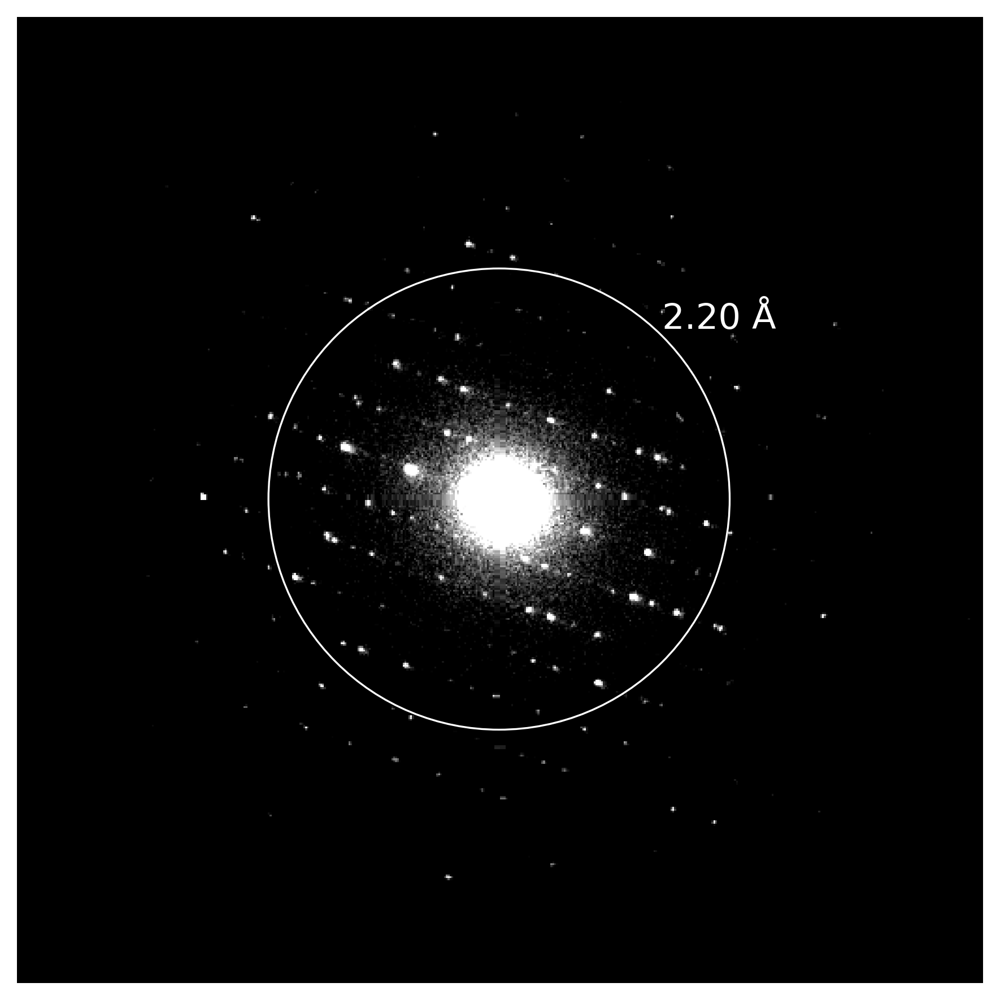

# draw_resolution_rings

A small script that draws resolution rings (and an optional reciprocal-space scale bar) over electron diffraction patterns, producing clean images ready for publication.

I wrote it for my own data and have only tested it on those images. If you need it to handle other cases, let me know.



## Requirements

- Python 3
- `numpy`
- `matplotlib`

```
pip install numpy matplotlib
```

## Usage

1. Edit the settings in `config.py`:

   | Setting | Meaning |
   |---|---|
   | `INPUT_PATH`, `OUTPUT_PATH` | Image to read and where to save the result |
   | `PIXEL_SIZE_UM` | Physical detector pixel size (µm) |
   | `CAMERA_LENGTH_MM` | Camera length (mm) |
   | `WAVELENGTH_A` | Electron wavelength (Å); 0.019687 Å = 300 kV |
   | `BEAM_CENTER` | Beam centre `(x, y)` in pixels, or `None` for the image centre |
   | `RINGS_D_A` | d-spacings (Å) to draw as rings |
   | `SCALE_BAR_INV_A` | Scale bar length in Å⁻¹, or `None` for no bar |
   | `CONTRAST_PERCENTILES` | e.g. `(1, 99.5)` to clip a bright central beam or hot pixels; `None` for the full range |
   | `COLOR`, `RING_LINEWIDTH`, `LABEL_FONTSIZE`, `DPI` | Appearance |

2. Run it:

   ```
   python draw_res_rings_ed.py
   ```

   You can also pass the paths on the command line instead of editing them in the config. Add `--no-show` to save without opening a window, which is handy for batches:

   ```
   python draw_res_rings_ed.py input.tiff output.png --no-show
   ```

   For other datasets or microscopes, make a small settings file containing only the values that differ from `config.py`. For example, `long_camera.py`:

   ```python
   CAMERA_LENGTH_MM = 1000.0
   RINGS_D_A = [4, 2.5, 1.5]
   ```

   and choose it with `--config`. Everything you don't set there comes from `config.py`:

   ```
   python draw_res_rings_ed.py --config long_camera.py
   ```

   A name that `config.py` doesn't define (usually a typo) is reported with a warning and ignored.

## How the ring radius is calculated

For each d-spacing the script uses Bragg's law and the detector geometry:

```
sin θ = λ / 2d
R     = L · tan(2θ)
```

and converts `R` to pixels using the detector pixel size. For electron wavelengths this is practically identical to the small-angle approximation `R = Lλ / d`.

Each ring is labelled on its upper-right diagonal. A label that would fall outside the image is skipped, and a warning is printed.

## License

BSD 3-Clause. See [LICENSE](LICENSE).
